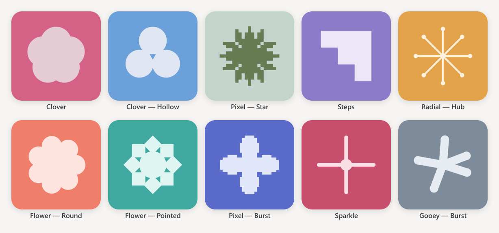

# claudie — Geometric Avatar Generator

A free avatar generator for clean, geometric profile pictures inspired by the Claude Desktop app.

Pick a colour palette, hit **Generate**, and get a crisp 512×512 PNG. No account needed, no tracking, no network requests — everything runs in your browser.

---

## Preview



---

## Patterns

| Pattern | Variations | Description |
|---|---|---|
| Clover | 3 | Overlapping round lobes around a filled centre — 3, 4 or 5 lobes |
| Clover — Hollow | 5 | The same ring with a hollow core cut as a polygon — 3 to 7 lobes |
| Flower — Round | 5 | Round petals around a solid centre disc — 5 to 9 petals |
| Flower — Pointed | 2 | Diamond petals, each with a vertex pointing outward — 7 or 8 petals |
| Pixel — Star | 5 | Chunky burst on a coarse pixel grid — 4, 6, 8, 10 or 12 blunt points |
| Pixel — Burst | 5 | Sharp spikes on a fine pixel grid — 4, 6, 8, 10 or 12 points |
| Steps | 1 | A solid staircase climbing from bottom-left to top-right |
| Radial — Hub | 4 | A central node with spokes radiating out — 4, 8, 12 or 16 spokes |
| Sparkle | 4 | A thick asterisk of rounded strokes — 4, 6, 8 or 12 arms |
| Gooey — Burst | 4 | The Claude mark fattened until the arms flow together |

Every pattern is normalised to the same bounding square, so they all read as the same visual weight on the disc.

---

## Usage

* Hit **Generate** to roll a new pattern, variation, palette and rotation.
* Choose any of the **16 curated palettes** by hand from the dropdown.
* Every motif also renders in **4 quarter rotations** and a **mirrored** version.
* Hit **PNG** to download the current avatar at 512×512.

Some patterns are weighted — Clover, Pixel — Star, Flower — Round, Pixel — Burst and Sparkle turn up twice as often as the rest. Steps is a single shape by design, so it stays rare.

---

## Quick Start

Requires **Node.js 20+**.

```bash
git clone https://github.com/isamyadeep/claude-avatar-generator.git
cd claude-avatar-generator
npm install
npm run dev
```

The dev server compiles the WebAssembly core first, then starts with hot reload.

| Command | What it does |
|---|---|
| `npm run dev` | Dev server with hot reload (compiles WASM first) |
| `npm run typecheck` | Type check on its own |
| `npm run build` | Type check, compile WASM, build for production |
| `npm run preview` | Preview the production build locally |

---

## Deploy

Push to `main` and GitHub Actions builds and publishes the site to **GitHub Pages** automatically — free, and still zero-server.

Enable it once: repo → **Settings** → **Pages** → **Source: GitHub Actions**.

The site then lives at `https://isamyadeep.github.io/claude-avatar-generator/`.

---

## How It Works

All pattern geometry lives in a single AssemblyScript file that compiles down to a small WebAssembly binary. The browser loads that binary and hands it the Canvas 2D primitives it needs to draw.

* **Geometry in WASM** — the pattern maths stays in a binary blob rather than readable JS
* **Curated palettes** — 16 hand-tuned colour pairs, chosen for harmony rather than generated
* **Quarter turns only** — motifs are built on a 90° grid, so any other angle just rasterises badly
* **Variants change the shape** — petal counts, lobe counts and spike counts, not just scale
* **512×512 canvas** — crisp on retina, downscales cleanly for profile pictures

---

## Project Structure

```text
├── index.html            # App shell — markup only
├── src/
│   ├── main.ts           # UI wiring: canvas, palette dropdown, buttons
│   ├── patterns.ts       # Pattern catalogue (metadata only)
│   ├── palettes.ts       # The 16 colour palettes
│   ├── styles.css        # All styling
│   └── wasm/
│       ├── draw.ts       # AssemblyScript source — all the geometry
│       ├── draw.wasm     # Compiled binary (build artefact, not committed)
│       └── index.ts      # WASM loader + Canvas 2D bridge
├── svgs/                 # Logo + favicon used by the app
├── docs/                 # Images used in this README
├── .github/workflows/    # GitHub Pages deploy
└── asconfig.json         # AssemblyScript compiler settings
```

---

## License

### GNU General Public License v3.0 (GPL-3.0)

This program is free software: you are free to redistribute and modify it under the terms of the GNU General Public License as published by the Free Software Foundation, either version 3 of the License, or (at your option) any later version.

This software is provided "as is", without warranty of any kind, express or implied, including but not limited to the warranties of merchantability, fitness for a particular purpose, and noninfringement.

Refer to the full text of the [GNU General Public License v3.0](https://www.gnu.org/licenses/gpl-3.0.html) for detailed terms.

---

*Crafted with assistance from [Claude Code](https://claude.ai).*

*Disclaimer: Not affiliated with, endorsed by, or connected to Anthropic or Claude.*
